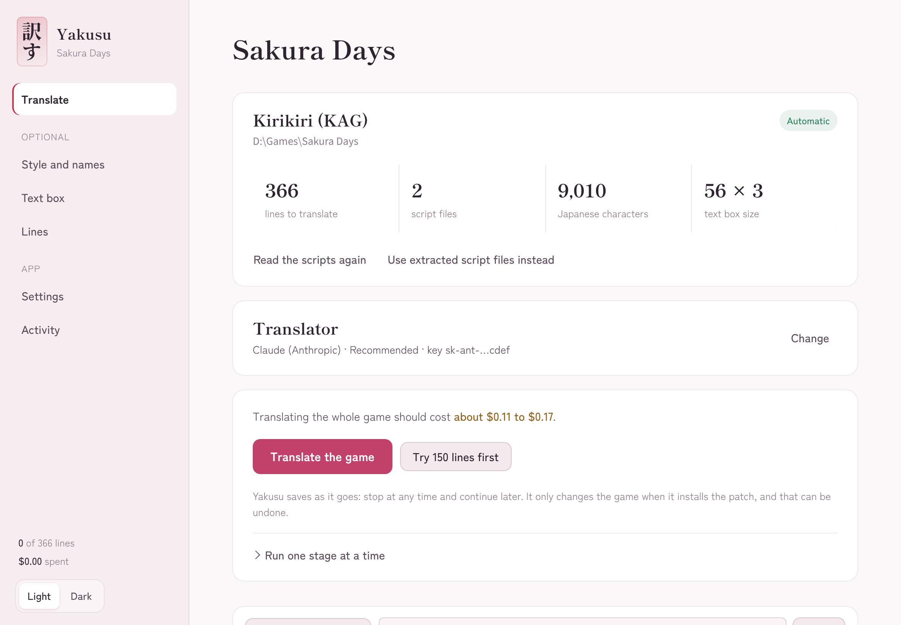

<p align="center"></p>

<h1 align="center">Yakusu 訳す</h1>

<p align="center">Translate Japanese visual novels into English.<br>Pick the game folder, paste an API key, play in English. Every change can be undone.</p>

<p align="center"><a href="../../releases/latest/download/Yakusu.exe"><b>Download Yakusu.exe</b></a> · Windows 10/11 · one file, nothing to install</p>



## Install

1. **[Download `Yakusu.exe`](../../releases/latest/download/Yakusu.exe)** from the latest release. It's one file: no installer, no admin rights, nothing else to download.
2. **Double-click it.** Windows may say it protected your PC (the file isn't code-signed): choose *More info*, then *Run anyway*. You only see this once per version.
3. Put it anywhere you like (Desktop, a Games folder). It keeps its data in `%LOCALAPPDATA%\Yakusu`, so moving the exe loses nothing.

**Update:** download the new `Yakusu.exe` and replace the old one. Projects, keys and settings carry over.

**Uninstall:** in Yakusu, *Remove the patch* from any game you patched, then delete `Yakusu.exe` and the `%LOCALAPPDATA%\Yakusu` folder.

Windows 10 or 11 (64-bit). It uses the Edge WebView2 runtime that Windows already includes.

## How to use it

1. **Pick the game's .exe** (or its folder). Yakusu recognises the engine and reads the script by itself.
2. **Paste an API key** (Claude, Gemini, OpenAI, OpenRouter, or a free local model). The cost is shown before anything is spent.
3. **Press *Translate the game*.** Yakusu works out the names and tone, translates, has a second model edit every line, shortens what won't fit the text box, then builds and installs the patch. Stop whenever you like; it picks up where it left off.

Not sure yet? *Try 150 lines first* installs a small test patch to check in the game. *Remove the patch* puts the original game back, byte for byte.

Everything else is optional: edit the style sheet and names, adjust the text box, or proofread lines one by one.

## What it handles

- **Engines:** Kirikiri (including ~500 encrypted games), LiveMaker, TyranoScript (loose, app.asar, package.nw or packed into the .exe), RPG Maker 2000, 2003, XP, VX, VX Ace, MV and MZ (messages, choices and database, including encrypted .rgss archives), Unity games made with Naninovel (experimental), FAVORITE, Artemis, BGI, YU-RIS, QLiE, Circus, Escu:de, plus CatSystem2 and Softpal with one manual step. Anything else works through *Use extracted script files instead*.
- **Quality:** a style sheet and name glossary every batch follows, a review pass by a stronger model, and a pass that rewrites lines too long for the game's text box. All of it runs from the one button.
- **Safety:** game codes are protected and checked on every line, and checked again right before the patch is written, so a model can't slip a command into the game. Archives can't write outside their folder, backups of the originals are never overwritten, removing a patch checks every backup before touching the game, and a failed re-read keeps the previous one. Progress is saved as it goes (stop any time).
- **Spending limit:** set a cap and Yakusu stops before a request could cross it. For models it has no price for, enter the price in Settings; it won't run a capped job it can't count.
- **Proofreading:** search and edit every line, or export a CSV and import it back.

Light (sakura) and dark (yozakura) themes; switch at the bottom of the sidebar.

## Building it yourself

It's a Rust workspace: `crates/core` is the engine, `src-tauri` the window, `ui` the interface.

```sh
cargo test -p yakusu-core      # the test suite, no network needed
# with the real msg-tool for the archive tests:
YAKUSU_REAL_MSG_TOOL=/path/to/msg_tool cargo test -p yakusu-core
cargo run -p yakusu            # run the app

# Windows release: fetch the bundled tools, then build Yakusu.exe
powershell -ExecutionPolicy Bypass -File packaging\fetch_tools.ps1
cargo install tauri-cli
cd src-tauri && cargo tauri build
```

`YAKUSU_FAKE_LLM=1` swaps in a stand-in model for trying the interface without a key.

## Credits

Yakusu drives these tools, which are packed inside `Yakusu.exe`:

- [msg-tool](https://github.com/lifegpc/msg-tool) by lifegpc (GPL-3.0): scripts and archives for most engines, and the Kirikiri decryption database. Built from a pinned commit with one small change, [`packaging/msg-tool-safe-paths.patch`](packaging/msg-tool-safe-paths.patch), which keeps unpacked archive entries inside their folder.
- [VNTextPatch](https://github.com/arcusmaximus/VNTranslationTools) and [KirikiriTools](https://github.com/arcusmaximus/KirikiriTools) by arcusmaximus (MIT). Yakusu's xp3 writer and descrambler are ports of KirikiriTools code.
- [pylivemaker](https://github.com/pmrowla/pylivemaker) by Peter Rowlands and tinfoil (GPL-3.0): Yakusu's LiveMaker reader and writer follow its documentation of the formats, and its sample files are used in the tests.
- [EasyRPG](https://easyrpg.org/): Yakusu's RPG Maker 2000/2003 reader follows liblcf's chunk layout (MIT), and the tests use files from EasyRPG TestGame (GPL-3.0).
- [UnityPy](https://github.com/K0lb3/UnityPy) by K0lb3 (MIT): Yakusu's Unity bundle reader follows its notes on the formats, and two of its sample bundles are used in the tests.
- Fonts: Shippori Mincho and Zen Kaku Gothic New (SIL OFL 1.1, licenses in `ui/fonts`).

Yakusu is licensed under GPL-3.0-or-later. Translate games you own, and don't share their scripts.
